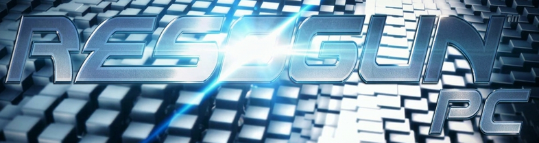

# Resogun (PS4) - Recompiled to PC

An (obviously) unofficial static recompilation of the PS4 version of <b>Resogun</b>, Housemarque's awesome shmup exclusive to PS platforms.

The game's own x86-64 code runs directly on Windows and Linux: the PS4 system libraries it calls are reimplemented, and its GPU commands are drawn with Vulkan.

🚨 **No game files are included** 🚨

This requires you to provide a decrypted dump of your own copy of the game. Only tested with **CUSA00038** with **update 1.10**.

## Features

- **30, 60, 90, 120, 144 or 180 FPS.** Higher framerates maybe possible in the future; 30 is for lower-powered PCs.
  - Note: if the game fails to reach the set FPS cap, it will run slower. So choose a cap that your device can reach.
- **4K support** (not native, the game's own checkerboard mode) or 1080p.
- **Aspect ratios (16:9, 4:3, 21:9 and 32:9):** ultrawide shows more of the level to the sides, 4:3
  more above and below, nothing stretched. The menus stay 16:9.
- **DLC support** from your own DLC dumps.
- **Built in skip intro:** (optionally) boots straight to the main menu, the start-up logos and the "Press X" screen are skipped.
- **Display settings in the game:** press **F10**, or hold **Select** (View, Back, Share) for two
  seconds, for window mode, resolution, VSync, frame rate and more.
- **Keyboard and any gamepad.** DualShock 4 and DualSense work as they are, Xbox-style pads by
  button position.
- **Easy setup:** point the installer at your dump, and it can add a desktop shortcut (on Linux, an application menu entry).
- **Works with [RecompLauncher](https://recomplauncher.com):** it installs and updates the game from these releases, sets it up from your dump and shows the settings on the game's page.

## Requirements

- **Windows:** Windows 10 or 11, 64-bit. Python and everything else comes with the release.
- **Linux:** x86-64 with glibc 2.39 or newer (SteamOS 3.7, Ubuntu 24.04, Debian 13, Fedora 40 or
  newer, Arch) and Python 3.10 or newer (`python3`) for the setup.
- A CPU with AVX.
- A GPU with Vulkan 1.3 and a current driver (on Linux, Mesa or the NVIDIA driver).
- A decrypted dump of your own copy of the game: the folder with `eboot.bin`, `sce_module`,
  `sce_sys`, `audio.pck` and `stream.dat`.

A higher frame rate needs a PC that holds it: Resogun's game speed follows the frames it shows, so a frame that comes late slows the game down for that moment.

## Install and play

1. [Download the latest release here](https://github.com/rcostanza/resogun-recomp/releases/latest)
2. Unzip the release anywhere, for example `C:\Games\Resogun`.
3. Run `resogun-setup.exe`.
4. Choose your **game folder** (the dump), optionally a **DLC folder**, and a **save folder** (by default `save` inside the release folder). Each row says whether the folder is usable, and **Install** turns on once the game folder holds your dump (and the DLC folder exists, if you named one). Press it: setup prepares the game from your dump in a few seconds and offers a desktop shortcut. Your dumps are only read, never changed.
5. Press **Play Game**. Later, start `resogun.exe` or the shortcut.

Run `resogun-setup.exe` again any time to change folders; it offers to copy your saves when the save folder moves. Untick **Skip the intro logos** there (or set `skip_intro=0` in `settings.ini`) to see the logos and the title screen again.

### On Linux

1. Extract the release anywhere you can write: `tar -xzf resogun-pc-<version>-linux.tar.gz -C ~/Games`
2. Run `resogun-setup`: from a file manager it asks with dialogs, in a terminal it asks there. It also
   takes `--game <dump> [--save <folder>] [--dlc <folder>]`.
3. Start the game from the menu entry it adds, or run `./resogun`.

On a Steam Deck, do this in Desktop Mode; _Add a Non-Steam Game_ in Steam then lists the menu entry.

### Updating

Unzip the new release over the old folder and run the setup once more (the game asks you to). Your folders, saves and settings are kept. Setup also remembers the folders in `%APPDATA%\Resogun\paths.ini` (Linux: `~/.config/resogun/paths.ini`), so a release unzipped somewhere new only needs **Install**.

### DLC

Resogun's add-ons (the extra ships and skins) carry no data of their own: the game only asks whether each one is installed. A DLC dump is a folder holding `sce_sys`, named after the add-on's label, the end of its content ID (`UP9000-CUSA00038_00-ASTRONAUT0000002` is `ASTRONAUT0000002`):

```
<folder containing your DLCs>/
  ASTRONAUT0000002/
    sce_sys/
  ...
```

## Settings

`settings.ini` in your save folder holds every setting, each with a comment. The **Display Settings** panel (**F10**, or hold **Select** for two seconds) changes most of them while the game runs and saves them when it closes:

- aspect ratio (4:3, 16:9, 21:9 or 32:9, at the next start), window mode, windowed resolution (the sizes of
  that ratio; applied a second after you stop changing it) and monitor. The fullscreen modes pick their
  size from the screen and the aspect ratio, with black bars when the screen is of another shape;
- VSync, and tearing with VSync off (the least input delay);
- frame rate: 30, 60, 90, 120, 144 or 180 (30 for PCs that cannot hold 60), held to what your display refreshes at (180 on a 120 Hz display runs at 120) unless VSync is off with tearing allowed;
- render resolution (4K or 1080p, at the next start);
- sharpening (AMD FSR 1 RCAS, on by default), applied at once; **F9** also switches it over the game, to compare;
- HDR, the game's own HDR output on an HDR display (at the next start; on Windows, turn on **Use HDR** in Display settings first).

`title_back_exits=0` stops Back on the title screen from asking to close the game.

## Controls

The game sees one DualShock 4. Any gamepad works, mapped by button position: on an Xbox pad A B X Y
are Cross, Circle, Square, Triangle, LB/RB are L1/R1, LT/RT are L2/R2, Menu is Options and View
clicks the touchpad. The keyboard works alongside a gamepad:

| Keys                      | PS4                      |
| ------------------------- | ------------------------ |
| W A S D / I J K L         | left stick / right stick |
| arrow keys                | d-pad                    |
| Space, Enter              | Cross                    |
| Escape, Backspace, `;`    | Circle                   |
| F / H                     | Square / Triangle        |
| Q, Page Up / O, Page Down | L1 / R1                  |
| E / U                     | L2 / R2                  |
| X / M                     | L3 / R3                  |
| Tab, P                    | Options                  |
| T                         | touchpad click           |

| Shortcut                                | What it does                                |
| --------------------------------------- | ------------------------------------------- |
| **F10**, or hold **Select** 2 s         | Display Settings                            |
| **F9**                                  | sharpening on or off                        |
| **F4**, or **Back** on the title screen | asks "Exit Resogun?" (No is selected first) |
| **Alt+F4**                              | closes the game without confirmation        |

## When something goes wrong

The game logs to `resogun.log` in the `log` folder of your save folder. If it closes by itself, it
says so and keeps that log as `crash-<date>-<time>.log` in the same folder; attach that file when
you report the problem. If the picture freezes, leave the game running for half a minute before
closing it: after 20 seconds without a new frame it writes what every thread is doing to the log.

## Building from source

[docs/building.md](docs/building.md) covers the toolchain, building, tests and packaging, and
[docs/development.md](docs/development.md) how the runner works and how to work on it.

## 🤖 AI usage disclaimer 🤖

**_This project was thoroughly made by AI._**

I (human) am a programmer, but I know nothing about C++ which is required to make this possible. And so, I've done precisely three things in this project:

1. Paid for AI
2. Told AI what to do
3. Tested out whatever AI did

## Credits and license

Based on and inspired by [theatrhythm-fbl-pc](https://github.com/YAPhoa/theatrhythm-fbl-pc).

GPL-2.0-or-later, see [LICENSE](LICENSE). Runtime follows [shadPS4](https://github.com/shadps4-emu/shadPS4). Resogun is a game by Housemarque, published by Sony Interactive Entertainment; this project is not affiliated with or endorsed by either.
